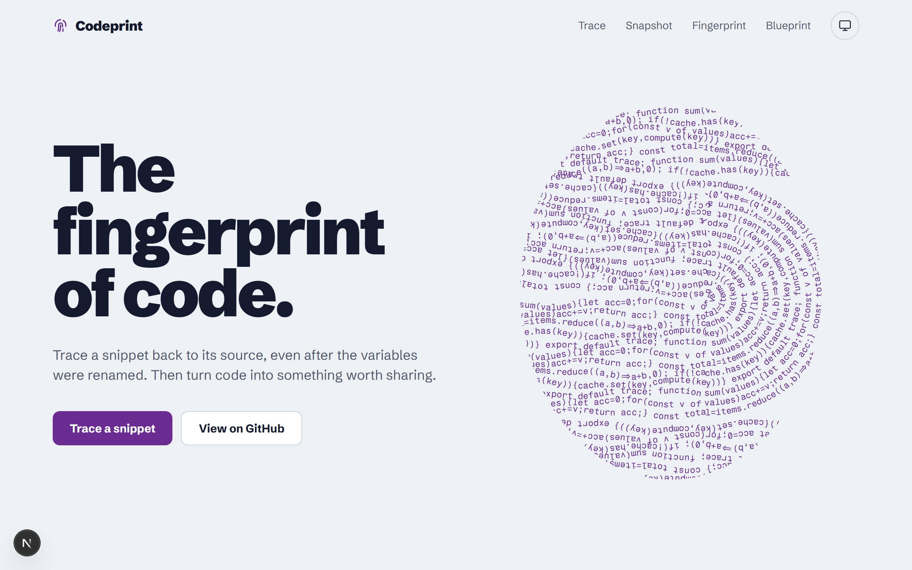
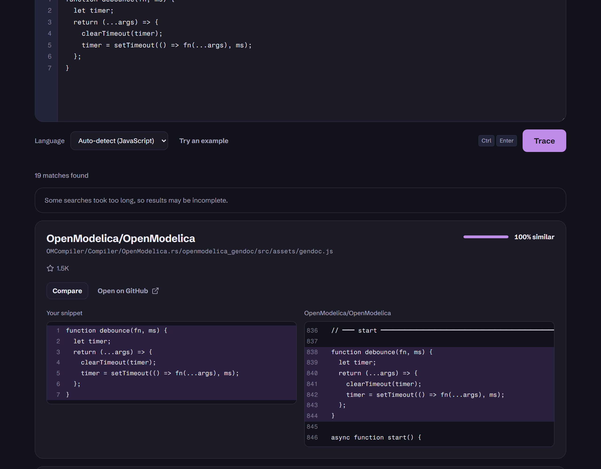

# Codeprint

> The fingerprint of code.

Codeprint is a toolkit for investigating code. Paste a snippet and trace it back to the public repositories it came from, even after every variable was renamed. Then turn code into something worth sharing.

<picture>
  <source media="(prefers-color-scheme: dark)" srcset="docs/assets/landing-dark.png" />
  
</picture>

## Tools

| Tool            | What it does                                                                                             | Status    |
| --------------- | -------------------------------------------------------------------------------------------------------- | --------- |
| **Trace**       | Finds public repositories containing a snippet, even when identifiers were renamed, ranked by similarity | Available |
| **Snapshot**    | Turns a snippet into a polished, shareable image                                                         | Phase 3   |
| **Fingerprint** | Generates unique art from a GitHub user or repository                                                    | Phase 4   |
| **Blueprint**   | Draws a repository's architecture as a technical blueprint                                               | Phase 5   |

## Trace



### How it works

Search engines match text, so renamed code slips past them. Trace compares structure instead:

1. **Tokenize** the snippet into keywords, names, strings and symbols. It supports JavaScript, TypeScript, Python, Java, C, C++, C#, Go, Rust, PHP and Ruby, plus a generic fallback, and detects the language automatically.
2. **Normalize** it: drop comments and whitespace, and replace every name with a placeholder, so `sum(values)` and `total(items)` look identical.
3. **Fingerprint** it with _winnowing_ (Schleimer, Wilkerson and Aiken, 2003), the algorithm behind Stanford's MOSS plagiarism detector.
4. **Search** public code with three kinds of queries:
   - the most distinctive line, verbatim
   - a structural regex where every name is a wildcard, so renamed copies still match
   - rare strings and method names
5. **Score** every candidate file by the share of the snippet's fingerprints it contains. Then find the matching lines and the renamed identifiers (`acc → total`), and rank by similarity, originals before vendored copies, then stars.

Results stream to the page as each file is scored.

| Parameter                 | Value                                            |
| ------------------------- | ------------------------------------------------ |
| k-gram size               | 5 tokens                                         |
| Winnowing window          | 4                                                |
| Minimum snippet           | 20 tokens                                        |
| Minimum similarity shown  | 25%                                              |
| Candidate files per trace | 20, fetched 5 at a time, up to 512 KB each       |
| Time per search           | 8 s, keeping whatever arrived before the cut-off |
| Rate limit                | 10 traces per minute per client                  |

### Sources

- [Sourcegraph](https://sourcegraph.com/search) public code search: used without a token, and supports regex.
- GitHub code search: optional. Set `GITHUB_TOKEN` in `.env.local` to add it.
- File contents come from `raw.githubusercontent.com` at the matched commit.

### Limits

- Trace only sees public code that these engines have indexed. Private code is invisible to it.
- Very short or very common snippets match almost everywhere. That is why there is a 20-token minimum.
- Regex searches over all public code can be slow. When one is cut off, Trace keeps what arrived and says the results may be incomplete.
- Similarity means "contains the same code structure", not "copied from". Trace points to where code exists; it does not judge who wrote it first.

The design is in the [design document](docs/superpowers/specs/2026-10-31-codeprint-design.md) and the [Trace addendum](docs/superpowers/specs/2026-10-31-trace-design.md).

## Quick start

Requires Node 22.

```bash
corepack enable
pnpm install
cp .env.example .env.local
pnpm dev
```

Then open http://localhost:3000.

Codeprint is a portfolio project and is intentionally not deployed: it runs locally.

## Scripts

| Command                             | Does                                                     |
| ----------------------------------- | -------------------------------------------------------- |
| `pnpm dev`                          | Starts the dev server                                    |
| `pnpm build` / `pnpm start`         | Builds and serves the production app                     |
| `pnpm test`                         | Runs unit and component tests (Vitest)                   |
| `pnpm test:e2e`                     | Runs end-to-end tests on desktop and mobile (Playwright) |
| `pnpm lint` / `pnpm typecheck`      | ESLint and TypeScript checks                             |
| `pnpm format` / `pnpm format:check` | Prettier                                                 |

## Project structure

```
src/
  app/                 Routes, kept thin: they compose features
  features/<tool>/
    domain/            Pure logic, no framework imports (enforced by ESLint)
    providers/         Adapters to external APIs
    ui/                The tool's React components
  shared/
    lib/               Small helpers and the tool registry
    ui/                Design system components
  env.ts               Validated environment
tests/e2e/             Playwright specs
docs/                  Design, plans, ADRs and the visual direction
```

## Testing

Codeprint is built test-first: every behavior starts as a failing test.

- **Unit and component:** Vitest with Testing Library, which asserts on what a person sees and does.
- **Network:** MSW intercepts every request. A request without a handler fails the test, so tests never reach the internet.
- **End to end:** Playwright on desktop Chrome and a Pixel 7 profile. It covers navigation, keyboard access, 404s, theme persistence without a flash, reduced motion and 360px layouts.
- **CI:** GitHub Actions runs format, lint, typecheck, unit and e2e on every push and pull request. `main` is protected by those checks.

## Design

Visual direction "Latent": a latent fingerprint developed with ninhydrin, the reagent that turns hidden prints purple. See [visual-direction.md](docs/design/visual-direction.md) for the tokens, type scale and motion rules.

## Contributing

See [CONTRIBUTING.md](CONTRIBUTING.md).

## License

[MIT](LICENSE)
